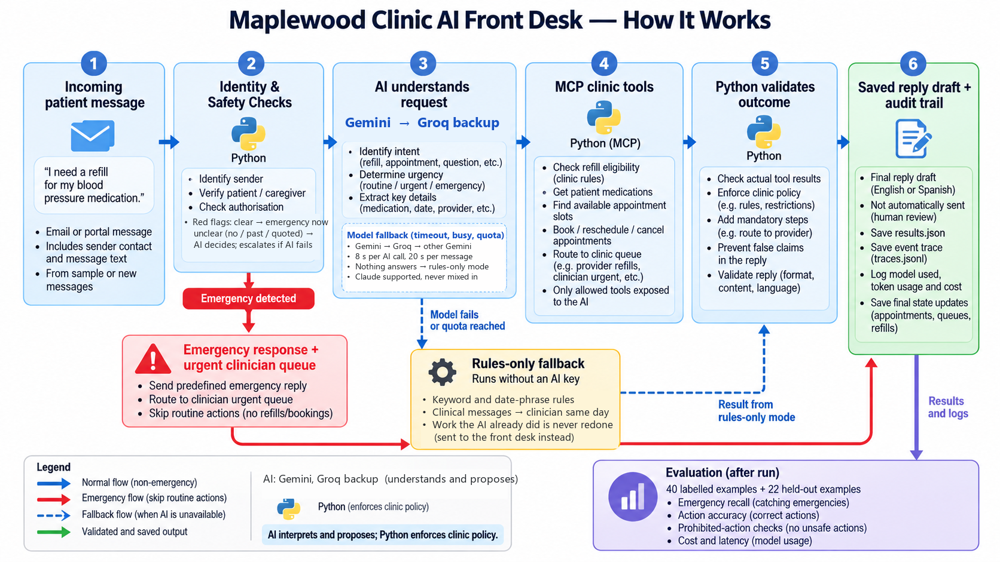

# Maplewood Front-Desk Agent

An AI agent that works a clinic inbox. It reads each message, works out who sent it, does the safe routine work
(refills for approval, bookings, cancellations, answers) through **MCP tools that enforce the clinic's policies in
code**, and hands everything risky to a human. It never answers an emergency itself. An **evaluation harness**
measures how well it does, including every failure.

> **The LLM proposes; Python disposes.** The AI model (Gemini, with Groq as backup) handles language and chooses
> tools. Python enforces every rule. MCP is the tool interface. The eval harness tells us how well it works.



- **How it works (plain explanation, modules, guardrails, interview Q&A):** [`docs/how-it-works.md`](docs/how-it-works.md)
- **How to run and test (full guide):** [`docs/how-to-run.md`](docs/how-to-run.md)
- **Before/after of the safety, deadline and Groq changes:** [`docs/results-before-after.md`](docs/results-before-after.md)
- Architecture diagram (open in draw.io): [`docs/architecture.drawio`](docs/architecture.drawio)
- System design (how it is built): [`docs/design/2026-10-21-system-design.md`](docs/design/2026-10-21-system-design.md)
- Intent and decisions (why): [`docs/design/2026-10-21-front-desk-agent-design.md`](docs/design/2026-10-21-front-desk-agent-design.md)

---

## Run it

```bash
python -m venv .venv && . .venv/Scripts/activate        # Windows (Git Bash); on macOS/Linux: . .venv/bin/activate
pip install -e ".[dev]"
# unzip edvak_forge_data.zip into ./edvak_forge_data (not committed)
cp .env.example .env                                     # then put GEMINI_API_KEY (or ANTHROPIC_API_KEY) in .env

frontdesk run                 # process the 40 sample messages with the AI, then evaluate
frontdesk run --mode rules    # same pipeline, no AI, no API key (offline baseline / fallback)
pytest                        # offline tests, no network needed
```

Live, on a message nobody has seen:

```bash
frontdesk run --text "Can I move my physical to next Tuesday morning?" --contact 555-0119 --name "Olivia Grant"
frontdesk run --text "my dad's face is drooping and he can't lift his arm" --contact 555-0999
```

Other commands:

| Command | What it does |
|---|---|
| `frontdesk run --quiet` | One line per message instead of a panel |
| `frontdesk run --ids M006,M017` | Only those messages |
| `frontdesk run --messages eval_sets/heldout/messages.json --labels eval_sets/heldout/labels.json` | The held-out set (see Results) |
| `frontdesk run --transport stdio` | The MCP server runs as a real subprocess (default: in-process; same protocol) |
| `frontdesk eval [--run DIR]` | Score a run again and print the report |
| `frontdesk show M017` | Replay one message's full trace (every stage, every tool call) |
| `frontdesk serve-mcp` | Run the clinic MCP server over stdio for any MCP client |

Each run writes `runs/<timestamp>/`: `results.json` (the brief's format), `traces.jsonl` (every event),
`trace_summary.json`, `state_final.json` (schedule, queues, prepared refills, outbox), `run_meta.json` (tokens,
cost, timings) and `eval_report.md/.json`. The latest full sample run is mirrored to `runs/latest/` and
`./results.json`.

---

## Architecture, and why

```
message ─► 1 Identify sender (code, MCP find_patient)
        ─► 2 Safety gate A: red-flag patterns (code) ──── emergency ──► fixed 911 reply, clinician_urgent, stop
        ─► 3 Understand (LLM, structured JSON output)
        ─► 2 Safety gate B: + the LLM's clinical concern (either signal escalates)
        ─► 4 Act (LLM chooses MCP tools; policy enforced INSIDE the tools; ends with submit_resolution)
        ─► 5 Enforce mandatory follow-ups (code) ─► derive actions FROM TOOL RESULTS (code)
        ─► 6 Reply: templates (EN/ES) or grounded draft ─► validator (code) ─► draft_reply (outbox, never sent)
        ─► result JSON + event trace ─► evaluation harness
```

| Decision | Why |
|---|---|
| **Policy lives in the tools**, not the prompt | A prompt can be argued with; `prepare_refill_request` re-checks all five refill rules, and there is no approve tool at all. Bookings are re-validated against hours, lunch, holidays, leave, overlaps and the :00/:20/:40 grid. |
| **The LLM never sees or chooses a patient id** | `find_patient` opens a per-message context. PHI tools get its id injected by the client, and unverified senders are not offered PHI tools at all. Prompt injection cannot reach another patient's record. |
| **Actions are computed from tool results**, not from what the LLM says | `prepare_refill_for_approval` is emitted only if `prepare_refill_request` succeeded. A claimed slot offer is checked against slots a tool actually returned. |
| **Two-part safety gate** | Keywords run before any LLM call: instant, free, and still working if the API is down. The LLM's judgement catches what keywords miss (Spanish, symptoms with no numbers). Either one escalates. A red flag inside a figure of speech ("dying to get in"), a negation, a past event, a question or a quote is deferred and cleared only by an explicit LLM all-clear; if the LLM fails it escalates. |
| **Provider chain + deadlines** | Gemini first, Groq as the backup (same tools, same Python rules). Each call has a timeout and each message a 20 s deadline; a slow or failing model is skipped for that call, an exhausted one for the run. Past the deadline the message continues without AI, with clinical messages routed to a clinician the same day. |
| **Templates for anything clinical or transactional** | Emergency and clinical wording is never generated. The LLM drafts only answers to general questions, and the validator rejects any date, time, price or phone number not found in the tool facts. |
| **Proportional processing** | Spam, thanks, third parties and unverified senders never reach the agent. An hours question costs one tool call. |
| **Mandatory follow-ups in code** | If the agent forgets a policy-required step (e.g. routing a controlled-substance refill to the prescriber), code performs it through the same MCP tool, and the trace records `by: code`. |
| **Graceful degradation** | If an LLM call fails for one message, that message falls back to the rules path, is marked `degraded`, and the run continues. If the AI had already booked or changed something, nothing is redone: the message goes to the front desk. |
| **Event stream** | Every stage emits typed events. The terminal renders them now, and the planned web UI will consume the same stream without changes to the pipeline. |

## What I reused vs built

**Reused:** the official **MCP Python SDK** (server + in-process/stdio client), the **Anthropic Python SDK**
(Messages API, structured outputs, tool use, prompt caching, server-side refusal fallback), **pydantic**, **rich**
(terminal UI) and **pytest**. No agent framework: the tool loop is about 60 lines, so every call can be logged,
context-injected and policy-checked. Claude Code (an AI coding assistant) was used heavily while building: it drafted much of the code, the held-out set and its labels. The design, the safety and policy behaviour and the evaluation results were
reviewed by me; the code is covered by offline tests.

**Built:** the clinic policy engine (refill rules, slot validation, calendar, identity, medication-name matching),
the 14-tool MCP server, the safety gate, the understander and agent prompts and schemas, the rules baseline,
outcome derivation, bilingual templates, the validator, the event and trace system, the CLI, the evaluation harness
(including deterministic `must_not` checks and schedule-integrity checks), a 22-message held-out evaluation set,
and the tests.

---

## Results

Two evaluation sets:

1. **The 40 labelled sample messages.**
2. **A held-out set of 22 new messages** (`eval_sets/heldout/`). They were written and labelled (with an AI coding
   assistant) from `clinic.json` policy **after** the system was built, and never used for tuning. Because the
   expected answers were AI-drafted, treat this set as a generalisation check, not ground truth. They include emergencies with no obvious
   keywords (a Spanish allergic reaction, low blood sugar with no number, stroke signs from a non-patient), new
   injection wording, a brand-name refill, name+DOB verification, a verified patient asking about someone else,
   and leave/holiday scheduling.

LLM runs: `gemini-3.5-flash-lite`, 2026-10-21, one run each (free-tier key, paced at 12 requests/minute).

| Metric | Rules · sample | Rules · held-out | **LLM · sample** | **LLM · held-out** |
|---|---|---|---|---|
| **Emergency recall** | **100% (5/5)** | **50% (2/4)** | **100% (5/5)** | **100% (4/4)** |
| **must_not violations** | **0** | **0** | **0** | **0** |
| Over-escalations | 0 | 0 | 0 | 0 |
| Urgency accuracy | 97.5% | 90.9% | 95.0% | 100% |
| Action exact-match | 95.0% | 50.0% | 85.0% | 95.5% |
| Action micro F1 | 97.9% | 56.0% | 94.0% | 98.1% |
| Patient-id accuracy | 100% | 100% | 100% | 100% |
| Schedule integrity problems | 0 | 0 | 0 | 0 |
| Messages degraded to rules | – | – | 0 | 0 |
| LLM calls per message | 0 | 0 | 3.1 | 3.0 |
| Cost per run (paid-tier prices) | $0 | $0 | $0.17 | $0.09 |

**Headline:** on unseen messages the LLM lifts emergency recall from 2/4 to 4/4 and exact-match actions from 50%
to 95.5%, with no increase in unsafe actions (0 `must_not` violations, 0 over-escalations in both modes).

### What the numbers mean, honestly

- **The rules baseline overfits the sample.** I wrote it with the 40 messages in view. It scores 95% exact on them,
  but 50% on unseen messages, and it **misses 2 of 4 held-out emergencies** (a Spanish allergic reaction, low
  blood sugar described without a number). This is why the LLM is the default and why the safety gate ORs the
  LLM's judgement into the keyword check. Rules mode is a fallback, not the product.
- **Where we "fail" the sample on purpose:**
  - **M004:** the label omits `route_to_provider`, but `clinic.json` says "not seen in 12 months: offer an
    appointment **and route to the provider**". We follow the policy, so the harness flags this as a *suspected
    label inconsistency* instead of hiding it (M026, the same situation, does include the routing).
  - **M019 (rules mode):** "pain is still bad" makes the keyword understander mark the message urgent and route
    it to a clinician as well as the provider. That is over-cautious, not unsafe.
- **What the LLM gets wrong (sample: 6 of 40 not exact; held-out: 1 of 22):** apart from M004 above, every miss is
  the same kind: the LLM judges a message more clinically urgent than the label and adds a same-day clinician
  route on top of the correct action (M005 "ran out early" on a controlled drug, M015 child's fever, M019
  post-surgery pain, M026 out of an antidepressant, M039 UTI symptoms, H015). These add human attention; none
  removes a required action or performs a forbidden one. Tightening this is prompt work on the `urgent_same_day`
  definition, measured against both sets so it does not cost emergency recall.
- **Judgement calls, documented:**
  - **M022:** Hannah has *two* appointments tomorrow and says "something came up", so both are cancelled and
    listed in the reply.
  - **`patient_id`:** this is the patient the message is *about* (the labels expect this for M011 and M027), even
    when the sender is unverified. Verification status is recorded separately in the trace.
  - **M006:** low mood without explicit intent → same-day `clinician_urgent` routing; the reply only says a
    clinician will contact them today (any crisis conversation is left to that human), and the eligible refill is
    still prepared. Explicit or imminent self-harm wording escalates as an emergency.

### Known weaknesses

- **The deterministic safety rules are not clinical coverage.** They were written by an engineer from public
  red-flag guidance (heart attack and stroke warning signs, breathing, anaphylaxis, hypoglycaemia without numbers,
  seizures, unconsciousness, overdose, dangerous bleeding, explicit self-harm, common Spanish phrases and spelling
  variants), are not clinically reviewed, and are tested only on synthetic messages (`tests/test_safety_probes.py`:
  48 emergency and 20 non-emergency phrasings). Any wording they do not anticipate depends on the LLM.
- **Context handling is heuristic.** A red-flag phrase that is negated right before it ("no chest pain"), historical
  ("history of stroke", "in 2019"), an information question ("signs of a stroke?") or quoted is not escalated
  instantly but deferred to the LLM; if the LLM is unavailable it escalates. Unusual phrasing can still produce a
  false alarm or rely on the LLM to catch a real emergency.
- **Rules-mode understanding is brittle** on new phrasing ("resurtir", "update my address").
- **Slot choice is "earliest valid".** It does not consider provider language match (e.g. a Spanish-speaking NP
  for a Spanish-preferring patient), and an `inproc` run processes messages sequentially by arrival time.

## Model choice and cost

- **Provider:** one provider layer (`frontdesk/llm.py`) serves Gemini (`google-genai`) or Claude (`anthropic`).
  The rest of the pipeline does not know which is behind it.
- **Default model `gemini-3.5-flash-lite`** (chosen after testing tool calling and JSON output on the available
  Gemini models). If its daily quota runs out, the run switches to the next model in `FRONTDESK_MODEL_FALLBACKS`
  and says so; when all are exhausted, or the `FRONTDESK_MAX_COST_USD` / `FRONTDESK_MAX_TOKENS` cap is hit, it
  raises a red alert, stops calling the model and finishes the run in rules mode (marked `degraded`).
- **Calls per message (measured):** about 3 on average. Emergencies caught by keywords use **0**. Simple messages
  use 1 (understand). Actionable ones use 1 + about 2–4 agent turns.
- **Measured cost:** 40-message sample run: 123 calls, 303k input + 32k output tokens = **$0.17 at paid-tier
  prices (about $0.004 per message)**. Held-out run: $0.09. A free-tier key is not charged but is rate-limited
  (about 15 requests/minute and a small daily quota per model), which is why the measured run took 14 minutes;
  latency figures in the reports include that deliberate pacing.
- Claude is supported (`--model claude-sonnet-5-5` with `ANTHROPIC_API_KEY`) but was not run for these results.

## What I'd do with another week

1. Run both sets **3–5 times** and report mean ± range (`--repeat`). LLM outputs vary, and one run is anecdote;
   the results above are single runs because of free-tier quotas.
2. Get a **clinician-reviewed, multilingual red-flag list**, plus a tiny fast classifier as a third safety signal.
3. **Grow the held-out set to around 200 messages** with a second labeller, measure inter-rater agreement, and
   track a confusion matrix per action.
4. **Web UI** on the existing event stream: live pipeline view, inbox, queues, and a schedule calendar, with
   human approve/edit of every draft before it can be sent.
5. A smarter slot choice (language match, continuity, patient's stated constraints), and a reply-back flow so
   offered slots can be confirmed.
6. Model/effort sweep: a cheaper model for understanding and a stronger one only for the agent turns, to cut cost per message
   while holding the safety metrics.

## Before this touches real patient data

- A **BAA** with the LLM provider, zero-data-retention settings, and PHI minimisation in prompts (send only what
  the step needs); redact or encrypt traces.
- **Real identity verification** (portal auth / OTP), not name + DOB alone.
- **AuthN/AuthZ on the MCP server**, per-tool scopes, rate limits, and an immutable audit log of every tool call.
- **Human approval** of every outgoing message and every schedule change at first, then graduated autonomy per
  action type, earned with measured accuracy.
- **Clinical governance:** sign-off on the red-flag list and templates, an incident process, and monitoring of
  missed-emergency and override rates in production.
- Encryption at rest/in transit, backups, retention policy, a real database with transactional booking
  (concurrency), integration with the actual EHR/PM system, and accessibility and language review of templates.

---

## Project layout

```
frontdesk/
  policy/        refill.py scheduling.py calendar.py identity.py medications.py   (pure rules, unit-tested)
  tools/         service.py (all tools) · mcp_server.py (MCP) · client.py (MCP client + ledger + context injection)
  understand/    llm.py (LLM structured output) · rules.py + dates.py (baseline) · schema.py
  act/           llm_agent.py (LLM tool loop) · rule_agent.py (baseline) · resolution.py
  safety.py  outcome.py  reply/ (templates, compose, validate)  pipeline.py  runner.py  events.py  render.py  cli.py
  eval/harness.py
eval_sets/heldout/   22 held-out messages + labels
tests/               offline tests (policy, identity, safety, MCP tools, pipeline, validator, harness, LLM loop with a fake model)
edvak_forge_data/    the provided data (synthetic)
```
