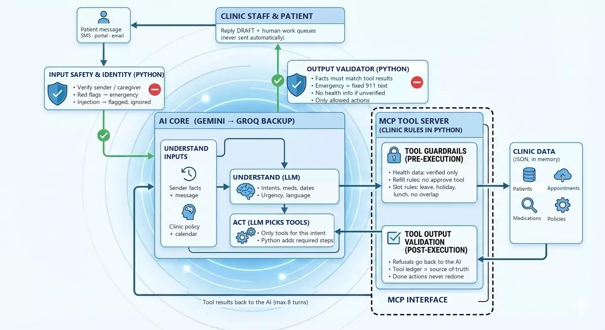

# Maplewood Front-Desk Agent

An AI agent that works a clinic inbox. It reads each patient message, checks who sent it, catches emergencies
first, does the safe routine work (refills prepared for a doctor's approval, bookings, cancellations, answers)
through **MCP tools that enforce the clinic's policies in code**, and hands everything risky to a human. It never
sends anything itself: every reply is a checked draft. An **evaluation harness** measures how well it does,
including every failure.

> **The AI proposes; Python enforces.** The AI model (Gemini, with Groq as backup) understands the message and
> chooses tools. Python enforces every clinic rule. MCP is the tool interface. The evaluation shows how well it works.

---

## 1. How to run it

**Requirements:** Python 3.11+, the data file `edvak_forge_data.zip`, and a free [Gemini API key](https://aistudio.google.com/)
(optional: a [Groq key](https://console.groq.com/) as the backup). Without any key the app still runs in
keyword-rules mode.

**Windows (PowerShell):**

```powershell
python -m venv .venv
.\.venv\Scripts\Activate.ps1
pip install -e ".[dev]"
Expand-Archive edvak_forge_data.zip -DestinationPath edvak_forge_data     # the provided data (not in git)
Copy-Item .env.example .env; notepad .env                                 # fill in GEMINI_API_KEY (and GROQ_API_KEY)
```

**macOS / Linux:**

```bash
python -m venv .venv && . .venv/bin/activate
pip install -e ".[dev]"
unzip edvak_forge_data.zip -d edvak_forge_data
cp .env.example .env    # then fill in GEMINI_API_KEY (and GROQ_API_KEY)
```

**Run:**

```bash
pytest                                     # offline tests: no key, no network
frontdesk run                              # the 40 sample messages with the AI, then the scorecard
frontdesk run --mode rules                 # the same pipeline without AI (no key needed)
frontdesk run --text "Can I get my lisinopril refilled?" --contact 555-0102        # one new message
frontdesk run --text "my dad's face is drooping and he can't lift his arm" --contact 555-0999
```

On a free-tier key, pace a full run: `FRONTDESK_MAX_RPM=12 FRONTDESK_CONCURRENCY=2 frontdesk run --quiet`
(PowerShell: `$env:FRONTDESK_MAX_RPM='12'; $env:FRONTDESK_CONCURRENCY='2'`).

| Command | What it does |
|---|---|
| `frontdesk run --quiet` | One line per message instead of a full panel |
| `frontdesk run --ids M006,M017` | Only those sample messages |
| `frontdesk run --messages eval_sets/heldout/messages.json --labels eval_sets/heldout/labels.json` | The 22 unseen messages |
| `frontdesk run --repeat 3` | Three runs, mean / min / max of every metric |
| `frontdesk eval [--run DIR]` | Re-score a saved run |
| `frontdesk show M017` | Replay every step of one message |
| `frontdesk serve-mcp` | Run the clinic MCP server over stdio for any MCP client |

More: [`docs/how-to-run.md`](docs/how-to-run.md) (settings, alerts, troubleshooting) and
[`docs/test-commands.md`](docs/test-commands.md) (copy-paste test messages for every behaviour).

Each run writes `runs/<timestamp>/`: `results.json` (the brief's format), `eval_report.md/.json`,
`traces.jsonl` (every step and tool call), `state_final.json` (schedule, queues, prepared refills, reply drafts) and
`run_meta.json` (models, tokens, cost, latency). `runs/` is git-ignored because it contains patient details.

## 2. What is in this submission

| Deliverable | Where |
|---|---|
| Code | this repository (`frontdesk/`), run instructions above |
| Evaluation results on the 40 sample messages | [`EVALUATION.md`](EVALUATION.md), plus `submission/results_sample40.json` (one result per message, brief format) and `submission/eval_report_sample40.json` |
| This README | `README.md` (a copy is in `submission/`) |
| AI usage, cost and plan | [`docs/ai-usage-and-cost.md`](docs/ai-usage-and-cost.md): requests and tokens per message, free-tier limits, monthly cost, recommended plan |
| Supporting docs | [`docs/how-it-works.md`](docs/how-it-works.md) (plain explanation), [`docs/results-before-after.md`](docs/results-before-after.md), [`docs/architecture.drawio`](docs/architecture.drawio), design notes in [`docs/design/`](docs/design/) |

## 3. How it works


Every message goes through the same six steps. Only the steps a message needs do real work (spam uses no tools, a
question about opening hours uses one), but the safety check and the final validator always run.

1. **Identify the sender** (Python): phone/email on file, name + date of birth, or an authorised caregiver.
2. **Safety check** (Python, then AI): red-flag patterns run first. Clear wording ("I can't breathe") is an
   emergency immediately, with no AI call: fixed 911 reply, urgent clinician queue, no routine work. Wording that is
   negated, in the past, quoted or a figure of speech ("dying to get in") is handed to the AI; if the AI is
   unavailable it escalates anyway.
3. **Understand** (AI): turns the message into structured data (intents, medication, dates, provider, urgency,
   language, suspicious instructions). The AI's own emergency judgement is checked here too; either check can escalate.
4. **Act** (AI + Python): the AI picks clinic tools through MCP. Every clinic rule lives inside the tools, so the AI
   cannot break them; Python adds any step the policy requires that the AI skipped.
5. **Outcome** (Python): actions and human queues are derived from what the tools actually did, not from what the
   AI says it did.
6. **Reply** (Python): templates filled with confirmed tool results (English or Spanish). The AI only drafts answers
   to general questions. A validator checks every reply; the draft is saved for staff, never sent.

A plain-language walkthrough with the tools, guardrails and likely questions is in
[`docs/how-it-works.md`](docs/how-it-works.md).

## 4. Architecture, and why



| Decision | Why |
|---|---|
| **Policy lives in the tools**, not the prompt | A prompt can be argued with. `prepare_refill_request` re-checks all five refill rules, and there is no approve tool at all. Bookings are re-validated against hours, lunch, holidays, leave, overlaps and the :00/:20/:40 grid. |
| **The AI never sees or chooses a patient id** | `find_patient` opens a per-message context; health-data tools get its id injected by the client, and unverified senders are not offered those tools at all. A prompt injection cannot reach another patient's record. |
| **Actions come from tool results** | `prepare_refill_for_approval` appears only if `prepare_refill_request` succeeded; an offered slot must be one a tool actually returned. |
| **Two-part safety check** | Keywords run before any AI call: instant, free and working when the API is down. The AI catches wording the keywords miss. Either escalates; an AI failure never clears a possible emergency. |
| **Templates for anything clinical or transactional** | Emergency and clinical wording is never generated. AI-drafted answers are rejected if they contain a date, time, price or phone number the tools did not return. |
| **Provider chain, timeouts, deadline** | Gemini first, Groq as backup. 8 s per AI call, 20 s per message; a slow model is skipped for 30 s, one out of quota for the run. Past the deadline a message continues without AI, with clinical messages sent to a clinician the same day. Work the AI already completed is never redone. |
| **Spending guard** | Every message shows calls, tokens and cost; a run stops calling the AI and alerts when the budget or every model's quota runs out. |
| **Typed event stream** | Every step emits an event: the terminal renders them, `traces.jsonl` stores them, the evaluation reads them. A web UI prototype that streams the same events lives on the `ui-prototype` branch (not part of the brief). |

## 5. The modules

| Module | Responsibility | Files |
|---|---|---|
| Clinic policy | Refill rules, slot validation, calendar, identity matching, medication-name matching. Pure functions, unit-tested | `frontdesk/policy/` |
| MCP tool server | 14 tools over the clinic data; rules enforced inside each tool; the AI can call 11 of them | `frontdesk/tools/service.py`, `mcp_server.py`, `client.py` |
| Safety gate | Red-flag patterns with negation / history / quote / idiom handling; combines the AI's judgement | `frontdesk/safety.py` |
| Understand | AI structured output; keyword-rules fallback | `frontdesk/understand/` |
| Act | AI tool loop (tools scoped per intent); rules fallback | `frontdesk/act/` |
| Outcome | Mandatory follow-ups in code; actions and queues from the tool ledger | `frontdesk/outcome.py` |
| Reply | EN/ES templates, grounded AI answers, validator | `frontdesk/reply/` |
| AI providers | Gemini, Groq and Claude behind one interface; chain, timeouts, retries, cool-down, cost and quota accounting | `frontdesk/llm.py`, `frontdesk/config.py` |
| Pipeline and runner | The six steps per message; batch runs; output files | `frontdesk/pipeline.py`, `frontdesk/runner.py` |
| Evaluation | Scores against labels; deterministic `must_not` and schedule-integrity checks | `frontdesk/eval/harness.py` |
| Events and CLI | Event bus, terminal rendering, commands | `frontdesk/events.py`, `render.py`, `cli.py` |

The MCP tools: `find_patient`, `get_medications`, `check_refill_eligibility`, `prepare_refill_request`,
`get_patient_appointments`, `find_open_slots`, `check_slot`, `book_appointment`, `reschedule_appointment`,
`cancel_appointment`, `get_clinic_info`, `route_to_queue` (five human queues), and the program-only
`draft_reply` and `export_state`.

## 6. Technology used

| Part | Choice |
|---|---|
| Language | Python 3.11+ |
| Tool interface | Official MCP Python SDK (in-process client by default; `--transport stdio` runs the server as a real subprocess) |
| AI | Gemini via `google-genai` (default `gemini-3.5-flash-lite`); Groq via its OpenAI-compatible API over `httpx` (`qwen/qwen3.8-27b`, `openai/gpt-oss-120b`) as backup; Claude via the `anthropic` SDK supported but not used for the reported results |
| Data | The provided JSON files, loaded into memory; bookings and cancellations last for one run |
| Validation and terminal | `pydantic`, `rich`, `python-dotenv` |
| Tests | `pytest`: 173 offline tests (policy, identity, safety phrasings, tools, pipeline, validator, harness, providers, deadlines) |

## 7. Results (40 sample messages)

Full report, with all 40 messages, the configuration and the failure analysis: **[`EVALUATION.md`](EVALUATION.md)**.

| | AI (this submission) | No AI (keyword rules) |
|---|---|---|
| **Emergencies caught** | **5 / 5** | 5 / 5 |
| **Prohibited actions (`must_not`)** | **0** | 0 |
| **False emergency alarms** | **0** | 0 |
| Urgency within accepted set | 92.5% | 97.5% |
| Actions exactly as labelled | 75.0% | 95.0% |
| Action recall (required actions present) | 97.9% | 100% |
| Messages finished without AI | 3 | – |
| Cost per run / per message (paid-tier prices) | $0.17 / $0.004 | $0 |

Run on 2026-10-22 at commit `f94d087`, one run, with the live configuration. The primary Gemini model was answering
in 16-18 s that day, so the backup chain (Groq and two other Gemini models) served every AI call.

**What the agent gets wrong:**

- **It is over-cautious.** In 5 messages it adds a same-day clinician call the labels did not ask for, and it rates
  3 routine messages as urgent.
- **One booking was not completed (M016).** It offered four valid slots instead of booking one.
- **One intent was misread (M030).** A lab-result question was also treated as a records request.
- **The validator blocked an invented date (M023).** That was the guardrail working.
- **M004 follows the written clinic policy over the label.**

None of these is unsafe. The keyword rules score higher on these 40 because they were written with these messages in
view. On 22 unseen messages they catch only 59% of actions exactly, against 95.5% with the AI, which is why the AI is
the default.

## 8. What I reused vs built

**Reused:** the official MCP Python SDK, the Gemini SDK (`google-genai`), Groq's OpenAI-compatible HTTP API,
the Anthropic SDK, pydantic, rich, python-dotenv and pytest. No agent framework: the tool loop is about 60 lines,
so every call can be logged, scoped and policy-checked.

**Built:** the clinic policy engine, the 14-tool MCP server, the safety gate, the understander and agent prompts and
schemas, the provider chain (timeouts, retries, cool-down, cost and quota alerts), the keyword-rules fallback,
outcome derivation, bilingual templates, the validator, the event and trace system, the CLI, the evaluation harness
(deterministic `must_not` and schedule checks), a 22-message held-out set, and the tests.

**How AI was used to build it:** Claude Code (an AI coding assistant) drafted much of the code, the held-out set
and its labels. The design, the safety and policy behaviour and the evaluation results were reviewed by me; the
code is covered by offline tests.

## 9. Model choice and cost

- **Default `gemini-3.5-flash-lite`**, chosen after testing tool calling and structured output on the Gemini models
  available to the key; **Groq** (`qwen/qwen3.8-27b`, then `openai/gpt-oss-120b`) as backup, measured at about
  0.2-1.5 s per call.
- **Calls per message:** emergencies caught by keywords use 0; simple messages 1; actionable ones about 3-5.
- **Full breakdown of requests, tokens, limits and the recommended plan:** [`docs/ai-usage-and-cost.md`](docs/ai-usage-and-cost.md).
- **Cost:** about **$0.004 per message, $0.15-0.20 per 40-message run** at paid-tier prices (exact figures in
  [`EVALUATION.md`](EVALUATION.md)). Free-tier keys are not charged but are rate-limited, so batch runs are paced.

## 10. Known weaknesses

- **The deterministic safety rules are not clinical coverage.** Written by an engineer from public red-flag
  guidance, not clinically reviewed, tested on synthetic messages only (48 emergency and 20 non-emergency phrasings
  in `tests/test_safety_probes.py`). Wording they do not anticipate depends on the AI.
- **Context handling is heuristic.** Negated, historical, quoted or informational red-flag wording is deferred to the
  AI and escalates if the AI fails; unusual phrasing can still cause a false alarm.
- **The AI is over-cautious** on some messages and adds a same-day clinician call the labels did not expect.
- **Rules-mode understanding is brittle** on new phrasing; it is a fallback, not the product.
- **Slot choice is "earliest valid"**; "next Wednesday" is read as the coming Wednesday.
- **Free-tier limits** (Gemini daily quotas, Groq tokens per minute) can push messages to the no-AI path during long
  runs; the report counts and lists them.

## 11. What I'd do with another week

1. Run both sets **3-5 times** and report mean ± range (`--repeat 3`); the reported results are single runs.
2. A **clinician-reviewed, multilingual red-flag list** and a small fast classifier as a third safety signal.
3. **Grow the held-out set to ~200 messages** with a second labeller and measure inter-rater agreement.
4. Tighten the AI's `urgent_same_day` judgement to remove over-caution without costing emergency recall.
5. Human review screen for drafts and queues (the `ui-prototype` branch is a start), and a reply-back flow so
   offered slots can be confirmed.
6. Smarter slot choice (language match, continuity, stated constraints) and a model sweep per step.

## 12. Before this touches real patient data

- A **BAA** with the AI provider, zero-data-retention settings, and only the minimum patient data in prompts;
  encrypted or redacted traces.
- **Real identity verification** (portal login or one-time code), not name + date of birth alone.
- **Authentication and per-tool permissions on the MCP server**, rate limits, and an immutable audit log.
- **Human approval** of every outgoing message and schedule change at first, then graduated autonomy per action
  type, earned with measured accuracy.
- **Clinical governance:** sign-off on the red-flag list and templates, an incident process, and monitoring of
  missed emergencies and false alarms in production.
- Encryption, backups, retention policy, a transactional database for bookings, integration with the real EHR and
  scheduling system, and accessibility and language review of templates.

## 13. Project layout

```
frontdesk/
  policy/        refill.py scheduling.py calendar.py identity.py medications.py   (pure rules)
  tools/         service.py (tools) · mcp_server.py (MCP) · client.py (MCP client, ledger, context injection)
  understand/    llm.py (AI structured output) · rules.py + dates.py (fallback) · schema.py
  act/           llm_agent.py (AI tool loop) · rule_agent.py (fallback) · resolution.py
  safety.py  outcome.py  reply/  llm.py  config.py  pipeline.py  runner.py  events.py  render.py  cli.py
  eval/harness.py
eval_sets/heldout/   22 unseen messages + labels
submission/          README copy, evaluation results for the 40 sample messages
docs/                how-it-works, how-to-run, test commands, diagrams, design notes
tests/               offline tests
```
