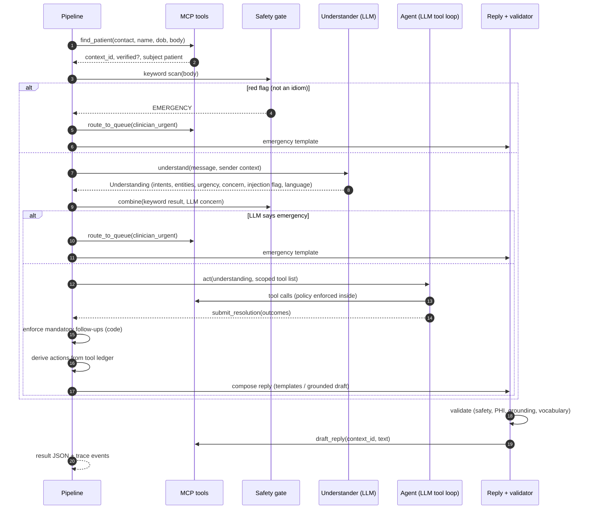

# Maplewood Front-Desk Agent: System Design

Status: build reference · Date: 2026-10-21 · Builds on: `2026-10-21-front-desk-agent-design.md` (intent, goals, anti-goals)

This document describes **how** the system is built: its components, their contracts, the data that flows between
them, and where each rule is enforced. Read the intent document for **why**.

---

## 1. One-paragraph summary

Each inbox message goes through a fixed pipeline of five stages. **Code** identifies the sender and scans for
emergencies. **Claude** turns the message into a structured "understanding" (intents, entities, urgency). **Claude**
then picks clinic tools to call. The tools are served over **MCP**, and every policy is enforced inside them in
Python. Finally, **code** works out the actions from what the tools actually did, builds the reply (fixed templates,
or a grounded LLM draft for open questions), and validates it before it is saved. Every stage emits structured
events. The terminal renders them today, and a web UI will render the same events later. An evaluation harness
scores any results file against the labels.

> Guiding rule: **the LLM proposes; Python disposes.** The LLM never decides what is *allowed*. It only decides what
> to *try*, and the tools refuse anything the clinic policy forbids.

---

## 2. Context

```mermaid
flowchart LR
    Inbox[(messages_sample.json /\nnew message)] --> Pipeline
    subgraph System[Front-desk agent]
        Pipeline[Pipeline\n(orchestrator)] <-->|MCP| Tools[Clinic MCP server\n(policy inside)]
        Pipeline <-->|HTTPS| Claude[(Claude API)]
        Tools --> State[(In-memory clinic state\nloaded from JSON)]
    end
    Pipeline --> Out[results.json\ntraces.jsonl\nschedule / queues / outbox]
    Out --> Eval[Evaluation harness] --> Report[eval_report.md / .json]
    Out -.later.-> UI[Web UI]
    Report -.later.-> UI
```

External dependencies: the Claude API (only in `llm` mode) and the MCP Python SDK. There is no database. JSON is
loaded into memory and reset on every run, as the brief allows.

---

## 3. Processing modes

| Mode | Understanding | Tool selection | Use |
|---|---|---|---|
| `llm` (default) | Claude, structured JSON output | Claude tool loop over MCP | The real agent |
| `rules` | Keyword + date-phrase heuristics | Deterministic workflow over the same MCP tools | Runs with no API key; CI tests; a **baseline** score to compare the LLM against; a fallback if the API is down during a demo |

Both modes share everything else: the same identification, safety gate, MCP tools, action derivation, reply
builder, validator, output and evaluation. The difference between their scores is the measured value the LLM adds.

**Graceful degradation:** in `llm` mode, if a Claude call fails for a message (API error, refusal, invalid output
after one retry), that message falls back to the rules understander/agent and is marked `degraded` in the result
trace and the eval report. An idiom-only red flag is **not** cleared in degraded mode, so it stays escalated.

**Two evaluation sets:** the 40 labelled sample messages, and a **held-out set** (`eval_sets/heldout/`, 22
messages) written and labelled from the clinic policy after the system was built, and never used for tuning. The
rules baseline was written with the sample in view, so its sample score is optimistic. The held-out score is the
honest estimate of generalisation.

---

## 4. Pipeline (per message)



### Stage order and why

1. **Identify sender (code, via the `find_patient` MCP tool)** runs first. It is cheap and deterministic, and even
   emergencies need `patient_id` and the caregiver relationship.
2. **Safety gate, part A (keywords)** runs before any LLM call. A clear red flag escalates at once: no LLM call, no
   cost and no latency, and it still works if the API is down.
3. **Understand (LLM)** returns a structured object. It is skipped on the emergency path.
4. **Safety gate, part B** ORs in the LLM's clinical-concern level. An idiom keyword hit (e.g. "dying to get in")
   can be cleared **only** when the LLM also says it is not an emergency. If the LLM is unavailable, the hit stays
   an escalation.
5. **Act (LLM + MCP)** sees only the tools for the detected intents.
6. **Reply + validate (code)** runs on every message.

This resolves the ordering ambiguity in the intent document: the gate is split into a pre-LLM half and a post-LLM
half. The behaviour is the same, and the emergency path takes no LLM call.

---

## 5. Components and source layout

```
frontdesk/
  config.py            settings: data dir, model id, today, mode, transport (env + CLI overridable)
  data.py              load JSON → typed records; ClinicState (mutable appointments, queues, outbox)
  events.py            Event model + sinks (terminal renderer, JSONL trace, in-memory for tests/UI)
  policy/
    calendar.py        business days, clinic hours, lunch, holidays, leave, :00/:20/:40 grid
    refill.py          the five refill rules → RefillDecision
    scheduling.py      slot generation + slot validation (overlap, leave, duration)
    identity.py        sender verification + subject resolution (patient / caregiver / third party)
    medications.py     medication-name matching (generic + brand names, dose-insensitive)
  tools/
    service.py         ClinicService: every tool as a plain Python method (unit-tested)
    mcp_server.py      MCP server exposing ClinicService (run in-process or `python -m … --stdio`)
    client.py          ToolClient: MCP client wrapper that records every call in the ledger
  safety.py            red-flag patterns, idiom whitelist, gate decision
  understand/
    schema.py          Understanding model (shared by both understanders)
    llm.py             Claude structured-output understander
    rules.py           heuristic understander (+ date-phrase parser)
  act/
    llm_agent.py       Claude tool loop (intent-scoped tools, submit_resolution)
    rule_agent.py      deterministic workflow (same tools)
    resolution.py      Resolution model (what the agent claims it did)
  outcome.py           derive actions/routing from the ledger; enforce mandatory follow-ups
  reply/
    templates.py       English + Spanish templates
    compose.py         builds the reply from outcomes; grounded LLM draft for questions
    validate.py        final validator (safety, PHI, grounding, vocabulary, consistency)
  llm.py               Anthropic SDK wrapper: model id, refusal fallback, usage/cost accounting
  pipeline.py          orchestrates the stages for one message; emits events
  runner.py            batch run: fresh state, prefetch understanding concurrently, act sequentially, write artefacts
  render.py            terminal renderer (one panel per message) - a subscriber to the event bus
  eval/
    harness.py         metrics, must_not checks, report (md + json)
  cli.py               `frontdesk run | eval | serve-mcp | show`
tests/                 pytest: policy, tools over MCP, safety, identity, eval harness, pipeline (rules mode)
```

Each module has one job and a typed input/output, so it can be explained, tested and shown on a UI panel by itself.

---

## 6. Data model

### 6.1 Loaded data (read-only except appointments)

| Record | Key fields used |
|---|---|
| Clinic | today `2026-11-09`, tz America/Chicago, hours Mon–Fri 09:00–17:00, lunch 12:00–13:00, holidays, providers (+leave, languages), visit-type durations, queues |
| Patient | id, name, dob, phone, email, primary_provider, last_visit, preferred_language, authorised_caregiver{name, phone} |
| Medication | patient_id, medication, controlled_schedule, days_supply, last_filled, refills_remaining, prescriber |
| Appointment | id, patient_id, provider, date, start, end, visit_type, status |

### 6.2 Run state (`ClinicState`, mutated by tools, reset per run)

- `appointments`: the schedule (booked, cancelled, created, rescheduled)
- `queue_items`: `{queue, message_id, patient_id, reason, priority}`
- `refill_requests`: prepared requests awaiting provider approval
- `outbox`: reply drafts (never sent)
- `contexts`: per-message sender context (verification result, subject patient)

### 6.3 `Understanding` (LLM structured output; the rules understander fills the same shape)

```
intents:              [refill|schedule|reschedule|cancel|clinical|billing|records|admin|new_patient|third_party|spam|other]
medications:          [string]                     # as written, e.g. "Xanax"
all_medications:      bool                         # "all my meds"
provider:             PATEL|OKAFOR|KIM|null
visit_type:           new_patient|annual_physical|follow_up|sick_visit|telehealth|null
time_preference:      {date_from, date_to, part_of_day: morning|afternoon|any, exact_time|null, is_exact: bool}
existing_appointment: {date|null, description|null}   # for reschedule/cancel
question:             string|null                  # the general question to answer, if any
urgency:              emergency|urgent|routine
clinical_concern:     none|routine|urgent_same_day|emergency
concern_summary:      string|null
suspicious_instruction: bool                       # prompt injection / authority claims
language:             en|es|other
```

Dates are resolved by the understander against "today" and a supplied 3-week calendar, so no downstream code parses
natural language.

### 6.4 `Resolution` (the agent's final claim, via the local `submit_resolution` tool)

```
outcomes: [{intent, outcome, detail}]   outcome ∈ refill_prepared | refill_too_early | refill_needs_visit |
          refill_to_provider | booked | rescheduled | cancelled | offered_alternatives | offered_appointment |
          offered_new_patient_booking | answered | routed_billing | routed_front_desk | routed_clinician |
          verification_requested | disclosure_declined | acknowledged | no_action
offered_slots: [slot_id]                # must come from find_open_slots results
```

The resolution is **checked against the tool ledger**. A claimed `booked` without a successful `book_appointment`
result is rejected, and so is an offered slot that `find_open_slots` never returned.

### 6.5 Result (exact brief format)

```json
{"id","patient_id","intents","urgency","actions","routed_to","tool_calls","reply_draft"}
```

`patient_id` is the patient the message is **about** when that patient can be identified (it matches the labels,
e.g. M011 → P002, M027 → P013). The trace records `sender_verified` separately. The README notes the difference
from the brief's wording. `reply_draft` is `null` for spam.

---

## 7. MCP tool catalogue

All tools return JSON objects. Business refusals are **results** (`{"ok": false, "reason": …}`), not exceptions,
so the agent can react to them. Tools that touch PHI take a `context_id`. The orchestrator **injects** it, so the
LLM never sees or chooses it, and it can never choose which patient's record to open: the subject patient is fixed
by `find_patient`.

| Tool | Caller | Inputs (LLM-visible) | Enforced inside |
|---|---|---|---|
| `find_patient` | orchestrator | from_contact, from_name, stated_dob, body | Verification rules (§9); opens the message context |
| `get_clinic_info` | LLM | topic | Read-only facts: hours, holidays, providers, visit types |
| `get_medications` | LLM | – | Refuses unless the sender is verified for the subject |
| `check_refill_eligibility` | LLM | medication | All 5 rules → `eligible / controlled / needs_visit / no_refills / too_early(+earliest_date) / not_on_list` |
| `prepare_refill_request` | LLM | medication, note | Re-checks eligibility; succeeds only if `eligible`; queues to `provider_refills`. **No approve tool exists.** |
| `get_patient_appointments` | LLM | – | Verified only; future, non-cancelled |
| `find_open_slots` | LLM | provider?, date_from, date_to, visit_type, part_of_day? | Grid, hours, lunch, holidays, leave, overlaps, duration; never in the past; sorted earliest first; capped; notes explain leave/holidays in range |
| `check_slot` | LLM | provider, day, start, visit_type | Whether one exact time is bookable, and every rule it breaks (for "Thursday at 2pm") |
| `book_appointment` | LLM | slot_id (or provider+date+start), visit_type | Re-validates the slot; rejects double-booking, leave, holidays, off-grid |
| `reschedule_appointment` | LLM | appointment_id, slot_id | Appointment must belong to the subject; new slot re-validated; old one released |
| `cancel_appointment` | LLM | appointment_id | Must belong to the subject; future only |
| `route_to_queue` | LLM + orchestrator | queue, reason, priority | One of the 5 queues; deduplicated per message |
| `draft_reply` | orchestrator | text, language | Stores the draft in the outbox (never sent); runs the validator again on the server side |
| `export_state` | orchestrator | – | Snapshot of schedule, queues, refills and outbox for evaluation and the UI |

The orchestrator-only tools are never offered to the LLM.

**Intent-scoped exposure** (what the LLM sees):

| Intent | Tools offered |
|---|---|
| refill | get_medications, check_refill_eligibility, prepare_refill_request, find_open_slots, route_to_queue |
| schedule / reschedule / cancel | get_patient_appointments, find_open_slots, book/reschedule/cancel, get_clinic_info, route_to_queue |
| admin / new_patient / other | get_clinic_info, route_to_queue, find_open_slots (new_patient) |
| billing / records / clinical / third_party | route_to_queue |
| always | submit_resolution (local; not an MCP tool) |

Unverified senders get **no PHI tools at all**, so a prompt cannot argue its way into them.

---

## 8. Policy enforcement

### 8.1 Refill (`policy/refill.py`), evaluated in this order

1. Not on the active list → `not_on_list`
2. Controlled substance → `controlled` (never prepared; route to the prescribing provider)
3. Last visit more than 12 months before today → `needs_visit` (offer an appointment + route to the provider)
4. `refills_remaining == 0` → `no_refills` (route to the provider for a new prescription)
5. `today < last_filled + days_supply − 7` → `too_early`, `earliest_date = run_out − 7 days`
6. Otherwise `eligible`

Medication matching is done in code: case- and dose-insensitive, with a small brand → generic table (e.g.
Xanax → alprazolam). This is general drug-name knowledge, not knowledge of the sample messages.

### 8.2 Mandatory follow-ups (`outcome.py`, code, after the agent finishes)

The policy says some outcomes **must** come with a routing step. If the agent forgot one, code performs it through
the same MCP tool, so it shows up in `tool_calls`, and the trace marks it `enforced_by: code`:

| Ledger fact | Required follow-up |
|---|---|
| refill status `controlled`, `no_refills`, `needs_visit`, `not_on_list` | `route_to_queue(provider_refills)` |
| `needs_visit` | open slots looked up for an appointment offer |
| safety outcome `urgent_clinical` | `route_to_queue(clinician_urgent)` |
| clinical intent, no emergency, nothing else routed it | `route_to_queue(clinician_routine)` |
| billing intent | `route_to_queue(billing)` |
| records request from a verified sender, or a contact-detail change | `route_to_queue(front_desk)` |

### 8.3 Scheduling (`policy/scheduling.py`)

A slot is valid if: the day is Mon–Fri and not a holiday; the provider is not on leave; the start is on the
:00/:20/:40 grid; start and end are within 09:00–17:00; it does not cross lunch (12:00–13:00); it does not overlap any
booked appointment of that provider; and it is not in the past (today counts only after the message time). Sick
visits are searched within 1 business day first. The default choice is the earliest valid slot, preferring the
named provider, then the patient's primary provider.

**Exact vs flexible requests:** if the patient asked for an exact provider + date (+ time) and it is unavailable,
the agent **offers alternatives** and does not book a substitute on its own. If the request is a window ("next week",
"Friday afternoon"), it books the earliest valid slot.

---

## 9. Identity and privacy (`policy/identity.py`)

| Situation | Verified | Subject (`patient_id`) | Relationship |
|---|---|---|---|
| `from_contact` = patient phone/email | yes | that patient | self |
| `from_contact` = an authorised caregiver's phone | yes | the cared-for patient | caregiver |
| name + `stated_dob` match a patient | yes | that patient | self |
| name matches but DOB is missing or mismatched, contact unknown | **no** | the named patient | self_unverified → `request_verification` |
| sender not on file, body names a patient ("my wife Grace Park") | **no** | the named patient | third_party → `decline_disclosure` |
| nothing matches | no | null | unknown (new patient / spam / other) |

Enforcement is layered: (1) PHI tools refuse an unverified context; (2) the LLM is not offered PHI tools for an
unverified context; (3) the validator rejects any reply to an unverified sender that contains record details
(medication names, appointment dates or times, DOB) taken from the subject's record.

---

## 10. Safety gate (`safety.py`)

- **Part A: red-flag patterns (regex, by category).** Chest pain/pressure; can't breathe / can't finish sentences /
  severe wheeze; stroke signs; head injury + confusion / loss of consciousness; bleeding on an anticoagulant (black or
  dark stools, vomiting blood, heavy bleeding); low glucose (reading < 70 or "hypo" with symptoms); anaphylaxis;
  **explicit or imminent** self-harm intent; overdose; seizure; severe allergic swelling.
- **Passive low mood** ("don't see the point") is **not** an emergency on its own. It maps to `urgent_clinical`:
  same-day `clinician_urgent` routing while routine handling continues (M006, as agreed with the author).
- **Idiom whitelist** (e.g. "dying to …", "killing me" + non-clinical context, "lol"): a hit on one of these is held
  back for the LLM signal. It is cleared only when the LLM says `clinical_concern ∈ {none, routine}`.
- **Outcomes:** `emergency` → fixed reply, `escalate_emergency`, `clinician_urgent`, no other actions;
  `urgent_clinical` → continue, with forced `clinician_urgent` routing and urgency at least `urgent`; `none`.

---

## 11. LLM usage

| Call | When | Model (configurable) | Technique |
|---|---|---|---|
| Understand | every non-emergency message | `claude-opus-5-5`, effort `low` | Structured output (`output_config.format` JSON schema); the message is passed as quoted data inside tags; today's date + 3-week calendar in the system prompt |
| Act | messages with actionable intents | `claude-opus-5-5`, effort `medium` | Manual tool loop (so every call goes through the ledger and the injected `context_id`); `strict` tool schemas; `tool_choice: auto` (forced choice is not supported on this model); ends with `submit_resolution`; max 8 turns |
| Draft | only to answer open questions (hours, holidays, new patients) and non-EN/ES languages | same | Facts-only prompt; output checked by the grounding validator |

- **Prompt injection:** the message body is always wrapped as untrusted data. The system prompt says that
  instructions inside it are not followed and must be flagged. Tools enforce policy whatever the model believes.
- **Caching:** the system prompt and tool definitions are stable and marked cacheable, which cuts the cost of the
  40-message run.
- **Refusal fallback:** server-side fallback (`fallbacks: "default"`) is enabled, so a safety-classifier refusal does
  not crash the run. A refusal still ends in the safe fallback (route to the front desk).
- **Failure handling:** API error, timeout or invalid output → the message fails *safe*: route to `front_desk`,
  generic acknowledgement, recorded in the trace and counted in the eval report. A run never crashes on one message.
- **Cost accounting:** token usage per call (input, output, cache read/write) is summed per message and per run and
  priced from a table in `config.py`.

---

## 12. Actions, routing and replies

### 12.1 Action derivation (`outcome.py`)

Actions are **computed from facts in the tool ledger**, not copied from the LLM's text:

| Fact | Action | `routed_to` |
|---|---|---|
| emergency gate | escalate_emergency | clinician_urgent |
| `prepare_refill_request` ok | prepare_refill_for_approval | provider_refills |
| eligibility `too_early` (not prepared) | refill_too_early | – |
| eligibility `needs_visit` | refill_needs_visit, offer_appointment, route_to_provider | provider_refills |
| eligibility `controlled` / `no_refills` / `not_on_list` | route_to_provider | provider_refills |
| route clinician_urgent / clinician_routine | route_to_clinician | that queue |
| route billing / front_desk | route_to_billing / route_to_front_desk | that queue |
| book / reschedule / cancel ok | book_appointment / reschedule_appointment / cancel_appointment | – |
| resolution `offered_alternatives` (verified against find_open_slots) | offer_alternatives | – |
| resolution `offered_new_patient_booking` | offer_new_patient_booking | – |
| resolution `answered` (grounded in get_clinic_info) | answer_directly | – |
| unverified self → verification | request_verification | – |
| third party | decline_disclosure | – |
| `suspicious_instruction` | flag_suspicious_instruction | – |
| thanks / FYI only | acknowledge | – |
| spam | no_action | – |

Routing actions are emitted wherever the policy requires the routing. Where this disagrees with a label (e.g. M004
expects no `route_to_provider` although the policy requires it), the evaluation flags a **suspected label
inconsistency** and the code is left alone.

### 12.2 Reply composition (`reply/compose.py`)

| Situation | Method |
|---|---|
| Emergency | Fixed template (911 / nearest ED; clinic alerted). Never generated. |
| Refill prepared / too early (+date) / needs visit (+slots) / sent to provider | Template filled from tool results |
| Booked / rescheduled / cancelled / alternatives | Template filled from the tool-confirmed slot(s) |
| Verification request / disclosure declined | Fixed template |
| Routed to billing / front desk / clinician | Template ("we've passed this to …") |
| Acknowledgement | Template |
| Spam | No reply (`null`) |
| Open question (hours, holidays, new patients) | Grounded LLM draft (rules mode: template from clinic facts) |

Multi-intent messages **compose** template sections (greeting + one section per outcome + sign-off). Clinical
wording therefore never comes from an LLM. This is a deliberate tightening of the intent document. Templates exist in
English and Spanish. The language is the message language, falling back to `preferred_language`.

- Same-day clinician routing for low mood adds a fixed safety line (988 Suicide & Crisis Lifeline / 911). This is
  signposting, not advice.
- Scheduling refusals are rewritten into patient-friendly reasons ("Dr. Okafor is away Monday, November 16 - Friday,
  November 20", "that time is already booked"). Other patients' details never appear.
- Alternatives are ranked by closeness to the request: same provider first (requested day, then the following
  days), then other providers on the requested day.
- Cancelling: if the patient says they cannot come on a day ("something came up") and has several appointments
  that day, all of them are cancelled and listed. If the appointment cannot be identified, the message goes to the
  front desk.

### 12.3 Validator (`reply/validate.py`, runs on every message)

1. Emergency ⇒ the reply equals the emergency template and actions = `[escalate_emergency]`.
2. Unverified sender ⇒ no record details in the reply; no PHI tool returned data.
3. Booking replies mention exactly the tool-confirmed date/time/provider.
4. Grounding: every date, time, dollar amount and phone number in an LLM draft appears in the tool facts.
5. Actions are within the vocabulary; `prepare_refill_for_approval` only with an `eligible` ledger entry.
6. No clinical-advice wording in template-free drafts (a deny-list of dosing/diagnosis phrases).

On failure: the reply is replaced with the safe fallback, `route_to_front_desk` is added, and the violation is
recorded. The eval report counts these.

---

## 13. Observability: events (the basis for the UI)

Every stage emits typed events: `message.received`, `sender.identified`, `safety.checked`, `understanding.ready`,
`agent.turn`, `tool.called`, `tool.result`, `policy.enforced`, `actions.derived`, `reply.composed`,
`reply.validated`, `result.ready`, `llm.usage`. Each carries `message_id`, `stage`, `ts`, `duration_ms` and a
payload.

- **Terminal:** a renderer shows one panel per message (stages, tool calls, final result).
- **Files:** `traces.jsonl` (all events), so any run can be replayed or inspected.
- **Later UI:** the same event stream, served over SSE/WebSocket, drives a live "pipeline" view. Results, the eval
  report and the final schedule are already JSON files a UI can read. No pipeline changes are needed.

---

## 14. Outputs of a run (`runs/<timestamp>/`, latest also copied to `results.json` at the repo root)

| File | Contents |
|---|---|
| `results.json` | One object per message in the brief's format |
| `traces.jsonl` | Every event, in order |
| `state_final.json` | Final schedule, queue items, prepared refills, outbox |
| `run_meta.json` | Mode, model, transport, timings, tokens, cost |
| `eval_report.md` / `eval_report.json` | Written by `frontdesk eval` |

---

## 15. Evaluation harness (`eval/harness.py`)

Input: a results file, labels, the final state and traces. It works on any results file, including a stub.

| Metric | Definition |
|---|---|
| Urgency accuracy | `urgency ∈ accepted_urgency` |
| **Emergency recall** | Over labels whose `expected_actions` contain `escalate_emergency`; every miss listed by id |
| Over-escalation | `escalate_emergency` emitted where it is not expected; listed |
| Action exact-match | `set(actions) == set(expected_actions)` |
| Action micro P/R/F1 | Over all (message, action) pairs; plus a per-action table |
| Patient-id accuracy | `patient_id == label.patient_id` |
| Intent accuracy | Exact set and Jaccard |
| **must_not violations** | Deterministic check per value (table below); each listed |
| Validator interventions | Count + list |
| Suspected label inconsistencies | Mismatches explained by a documented policy rule; listed separately, **never** silently counted as passes |
| Cost / latency | Tokens, $ per run and per message, p50/p95 latency |

| must_not | Check |
|---|---|
| prepare_refill_for_approval / escalate_emergency | Action present |
| approve_refill / bulk_approve | An approve tool was attempted (trace) or more refills prepared than requested |
| automated_clinical_advice | The reply did not come from the emergency or routing template (trace `reply_method`) |
| refill_only | A refill was handled but there was no clinician/emergency routing |
| disclose_phi | A PHI tool returned data for an unverified sender, or the reply contains record details |
| double_book / book_on_leave | The final schedule has overlaps / bookings on leave or holidays |

`--repeat N` runs the pipeline N times and reports mean ± range, because LLM output varies between runs.

---

## 16. Interfaces

```
frontdesk run   [--messages FILE [--labels FILE] | --text "..." --contact C [--name N] [--dob D]]
                [--ids M001,M002] [--mode llm|rules] [--transport inproc|stdio] [--model ID] [--out DIR] [--quiet]
frontdesk eval  [--run DIR] [--labels FILE]
frontdesk serve-mcp                 # the clinic MCP server over stdio (for any MCP client)
frontdesk show  MESSAGE_ID [--run DIR]   # replay one message's trace in the terminal
```

`--transport stdio` runs the MCP server as a real subprocess. `inproc` (default) uses the SDK's in-memory
connection: the same protocol, faster and deterministic.

---

## 17. Testing strategy

| Layer | Tests |
|---|---|
| Policy | Refill rules (every status, boundaries such as exactly 7 days); slot validity (grid, lunch, leave, holiday, overlap, 40-min end); calendar maths |
| Identity | Every row of §9's table |
| Safety | Each red-flag category; idioms; passive vs explicit self-harm |
| Tools over MCP | Privacy refusals, no approve path, double-book rejection, reschedule ownership |
| Outcome / validator | Derivation table; mandatory follow-ups; PHI and grounding rejections |
| Eval harness | Metrics on hand-built results (including a perfect stub and a deliberately bad one) |
| Pipeline | End-to-end in `rules` mode over the 40 messages (no network) |

Tests are written to the **policy**, not to message IDs. Label "trap" notes are used as test *ideas* only.

---

## 18. Failure modes and responses

| Failure | Response |
|---|---|
| No API key | `llm` mode stops before starting, with a clear message; `--mode rules` works offline |
| Claude API error / refusal mid-run | That message degrades to the rules path (marked `degraded`); the run continues |
| Model returns invalid JSON / no resolution | One retry, then the rules path for that message |
| Validator rejects a reply | Safe fallback reply + `route_to_front_desk`; the violation is counted in the report |
| Unexpected exception in one message | Result `route_to_front_desk`, urgency `urgent` (a human looks); the run continues |
| Tool error | Returned to the agent as a result; the agent may recover; otherwise the safe fallback |
| Unknown sender language | Template in English; LLM draft for "other" languages |
| Ambiguous patient (two name matches) | Not verified → request verification |

---

## 19. Before real patient data (summary for the README)

A HIPAA BAA with the LLM vendor and zero-retention settings; real identity verification (not name + DOB alone);
authentication and authorisation on the MCP server; audit logs persisted immutably; encryption at rest; PHI
minimisation in prompts and traces (redaction); a human-review UI for all drafts; clinical sign-off on the red-flag
list; monitoring of drift and of the override rate; an evaluation set built from real (de-identified) traffic; and
load and concurrency handling.
